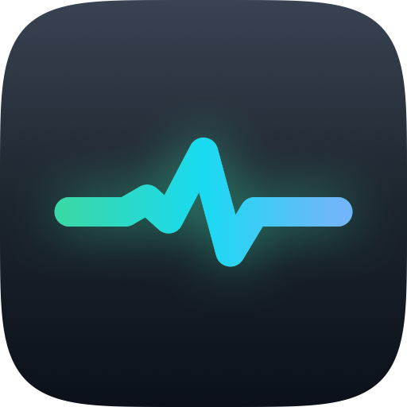

# Vitals

A local-only macOS menu-bar monitor for CPU, memory, network, disk, temperature, and battery. No dependencies or update checker.

**Requires:** Apple Silicon, macOS 14+, and the Xcode Swift toolchain. Liquid Glass needs macOS 26; earlier versions use a material background.

## Features

- A Control Center-style panel of Liquid Glass modules for every metric, with **Apps** and **History** tabs below them. Click a module to jump to its history.
- Top apps by CPU or memory, with grouped helpers and expandable process details. Tick **All processes** to include system services and command-line tools.
- Quit apps from the row’s actions menu, or Force Quit with confirmation.
- Sustained warnings that name the app responsible, such as `Top: Xcode 180%`.
- Per-core load split by performance and efficiency cores, memory breakdown, and swap.
- Battery charge, time remaining, system power draw, and cycle count.
- Interactive 5-minute or 1-hour charts with hover, pinning, and keyboard navigation.
- Shrinks to fit crowded menu bars, pauses during sleep, and reduces sampling in Low Power Mode.
- The gear icon, or right-clicking the menu bar item, opens **Settings**, Activity Monitor, the config file, and **Quit**.

100% app CPU equals one busy core. Resident memory totals may count shared pages more than once. Process scans run while the panel is open, and briefly when a CPU or memory warning fires. Root-owned processes can't be read, so a CPU warning names the top process only if it is at least a quarter of the load, or the processes Vitals can read are at least half of it; otherwise it names nothing rather than a bystander. A memory warning has no such check: it names the largest app Vitals can read, which may not be the cause when root-owned processes hold the memory. Network leaves out VPN tunnels and the virtual interfaces of common VM apps, so their traffic isn't counted twice. Traffic shared through Internet Sharing still is, because it crosses two physical interfaces.

Menu bar digits update at most every 3 seconds, or at once when a warning colour changes, because redrawing the status item is most of the app's idle cost. The panel and charts keep the full sample rate.

The last hour of charts and warnings survives relaunches, stored locally in `~/Library/Application Support/Vitals/history.json`. Temperature availability varies by Mac and uses a private Apple API.

## Install

```sh
git clone https://github.com/Abdulshakur24/mac-vitals.git
cd mac-vitals
./Scripts/build.sh
```

Builds, signs, installs to `/Applications`, and launches Vitals. Add `--no-install` to build only.

## Configure

Use **Settings** in the gear menu, or edit `~/.config/vitals/config.json`. Changes apply immediately, and the panel reports any mistake in the file.

```json
{
  "menuBar": ["cpu", "memory", "network", "temperature"],
  "sampleInterval": 1,
  "thresholds": { "cpu": 0.7, "diskFree": 0.1, "temperature": 90 }
}
```

Add `disk` for free disk space as a percentage or `battery` for charge; remove metrics to hide them. Earlier entries get priority when space is limited. Omitted settings use defaults.

## Development

```sh
swift test
swift run Vitals --probe
```

`--probe` prints a snapshot of all metrics without opening the app.

[MIT license](LICENSE).
